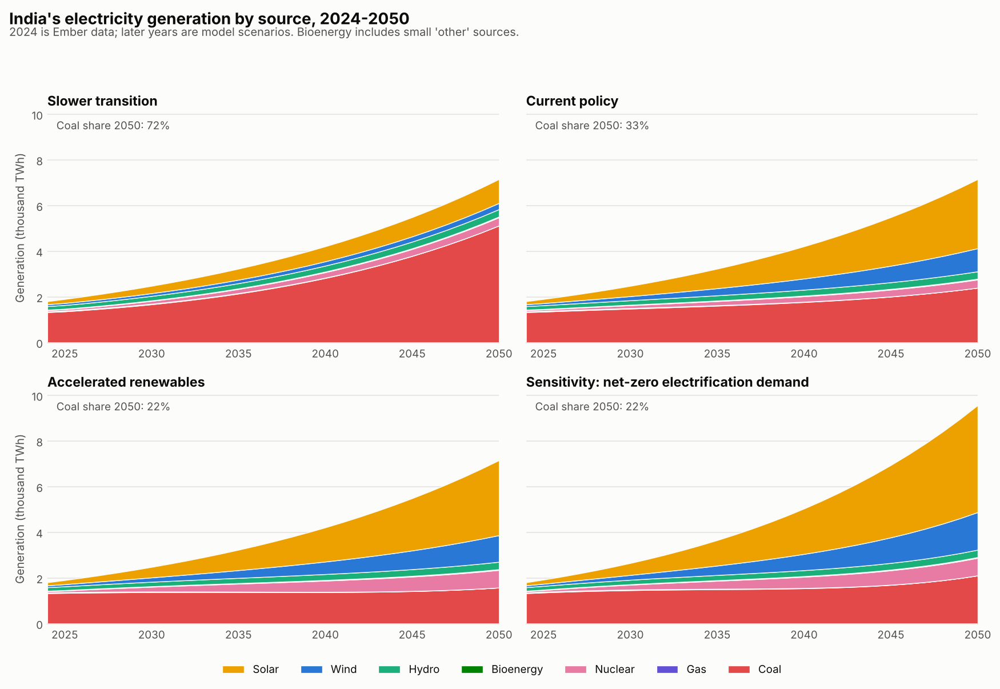

# How fast must India build renewables?


A transparent, reproducible scenario model of India's power sector from 2024 to 2050. It asks how fast solar and wind must grow to bend the coal trajectory, and what each pace implies for coal use, emissions and investment.

The model starts from Ember's 2024 national data and is benchmarked against NITI Aayog's 2026 *Scenarios Towards Viksit Bharat and Net Zero: Power*. Every assumption is sourced in [`data/assumptions.csv`](data/assumptions.csv).

**Research note (PDF, 5 pages):** [`note/research_note.pdf`](note/research_note.pdf)



## Key findings

| | Slower transition | Current policy | Accelerated renewables | Net-zero demand (sensitivity) |
|---|---:|---:|---:|---:|
| Solar + wind additions, 2030 (GW/yr) | 19 | 47 | 50 | 66 |
| Coal share of generation, 2050 | 72% | 33% | 22% | 22% |
| Coal generation, 2050 (TWh; 1,328 in 2024) | 5,125 | 2,398 | 1,575 | 2,106 |
| New coal capacity, 2025–2050 (GW) | 681 | 202 | 58 | 151 |
| Power-sector CO2, 2050 (Mt; 1,121 in 2024) | 4,275 | 2,143 | 1,487 | 1,995 |
| Cumulative CO2, 2025–2050 (Gt) | 59.6 | 39.6 | 32.3 | 36.9 |
| Investment, 2025–2050 (USD tn, 2025 prices) | 2.70 | 3.35 | 3.65 | 5.23 |

1. **The 2022–24 deployment pace is far too slow.** At about 19 GW of solar and wind a year, coal still supplies over 70% of generation in 2050, and about 680 GW of new coal plants would be needed.
2. **Even NITI's current-policy coal share implies 80% more coal generation than today in 2050.** Power-sector CO2 nearly doubles, although grid intensity halves.
3. **A path aligned with NITI's Net Zero coal share keeps coal generation roughly flat until the mid-2040s.** It needs about 9% more capital than current policy, avoids about 7 Gt of cumulative CO2 and about 145 GW of new coal capacity.
4. **Electrification raises absolute power-sector emissions even at the same grid intensity.** The net-zero-demand case also needs build rates above NITI's own expansion limits from 2030.

## How the model works

An annual energy-accounting model (`ipt/model.py`):

- **Demand** grows at the rate implied by NITI's 2025→2050 generation path. Growth rates are used rather than levels because NITI includes captive plants and Ember's base data are utility-scale.
- **Solar and wind** follow explicit build paths. The *Current policy* and *Accelerated* paths are calibrated so that coal's 2050 generation share matches NITI's Current Policy (33.5%) and Net Zero (22%) scenarios.
- **Fleet capacity factors** for solar and wind rise from Ember's 2022–24 values (18.7% and 20.4%) to the values implied by NITI's 2050 capacity and generation (23.5% and 26.3%).
- **Hydro, nuclear and bioenergy** follow NITI's capacity ranges. Gas declines to zero by 2050.
- **Coal is the residual supplier.** New coal capacity is added when existing plants cannot meet coal generation at a 65% load factor (NITI). Retirements are not modelled.
- **Emissions** use Ember's fuel emission factors (lifecycle basis).
- **Investment** uses CEA unit costs (NITI Table 3.7), battery storage sized with NITI's 2050 battery-to-VRE ratios, and NITI's ratio method for transmission and distribution.

### Validation against NITI Aayog

The model is calibrated only to NITI's 2050 coal shares. It reproduces NITI's other 2050 results as follows:

| Metric | Model: current policy | NITI CPS | Model: net-zero demand | NITI NZS |
|---|---:|---:|---:|---:|
| Solar capacity 2050 (GW) | 1,516 | ≈1,537 | 2,354 | ≈2,442 |
| Wind capacity 2050 (GW) | 451 | ≈437 | 736 | ≈744 |
| Battery storage 2050 (GW) | 452 | 420–520 | 997 | 900–1,150 |
| Investment 2025–2050 (USD tn) | 3.35 | 3.58 | 5.23 | 5.15 |

Full comparison, including where and why the model differs: [`results/benchmarks_vs_niti.csv`](results/benchmarks_vs_niti.csv) and section 3 of the note.

## Limitations

- **Not an optimisation or dispatch model.** It does not choose a least-cost mix or test hourly reliability, curtailment or prices.
- **Simple rules for coal.** Coal retirements and timing follow simple rules rather than economics.
- **Storage.** Battery capacity is scaled from NITI's ratios rather than sized for reliability, and pumped hydro is not costed.
- **Scope.** The base data are utility-scale only, so captive plants are excluded.
- **Emissions basis.** Emissions are on Ember's lifecycle basis, which differs from CEA's grid emission factors (621 vs 710 gCO2/kWh in the base year).
- **Costs.** Investment covers undiscounted capital costs only. Fuel, operations and financing costs are excluded.

## Run it

```bash
pip install -r requirements.txt
python run.py        # writes results/, figures/ and data/assumptions.csv
python -m pytest     # energy balance, calibration, base-year match, cost interpolation
```

The research note is written in [Typst](https://typst.app) (`note/research_note.typ`) and compiled to PDF.

## Repository layout

```
data/raw/ember_india_yearly.csv   Ember India Electricity Data, yearly (CC-BY-4.0)
data/assumptions.csv              every assumption with its source
ipt/assumptions.py                NITI and CEA benchmarks, costs, ratios
ipt/data.py                       loads Ember data; capacity and emission factors
ipt/model.py                      annual scenario model and calibration
ipt/scenarios.py                  scenario definitions
run.py                            runs everything; writes tables and figures
results/                          scenario time series, summary, benchmarks, sensitivity
note/research_note.pdf            the research note
```

## Data sources and licence

- **Ember** (2026), *India Electricity Data*, yearly release. Licensed under [CC-BY-4.0](https://creativecommons.org/licenses/by/4.0/) and redistributed here with attribution: <https://ember-energy.org/data/india-electricity-data>.
- **NITI Aayog** (2026), *Scenarios Towards Viksit Bharat and Net Zero: Sectoral Insights: Power (Vol. 7)*. Not redistributed; the figures used are cited by table and page in `data/assumptions.csv`. [PDF](https://niti.gov.in/sites/default/files/2026-02/Scenarios-Towards-Viksit-Bharat-and-Net-Zero-Sectoral-Insights-Power.pdf).
- **Central Electricity Authority** technology costs and grid emission factors, as reproduced in NITI Aayog (2026).

Code is released under the MIT licence.

Related: [a stock-flow consistent model of green public investment](https://github.com/mayurmankar-dev/sfc-green-sim). A natural extension is to feed this model's investment paths into that macro-financial framework.
